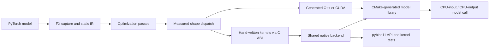

# tinyinfer

I use tinyinfer to follow a small PyTorch model from its graph to the code that executes it. The compiler and hand-written kernels share one native backend, so I can compare generated code with measured kernel substitutions on identical tensors and weights.



| Execution path | What runs |
|---|---|
| PyTorch eager | The reference model with the same weights and input |
| Compiler codegen | The optimized IR and generated compute loops |
| Compiler + kernels | Generated code with measured substitutions into the shared C++/CUDA backend |

```bash
./scripts/run_gpu.sh
```

This builds the unified backend, runs the compiler/kernel suite, calibrates dispatch, then records fresh GPU graph and host-call timings. It needs Python with PyTorch, NumPy, SciPy, pytest and pybind11, CMake 3.24+, a C++17/OpenMP compiler, nvcc and a CUDA GPU. `./scripts/run_cpu.sh` runs the corresponding CPU experiment; `./scripts/test.sh` runs correctness checks without benchmarking. `PYTHON` and `BUILD_DIR` select the interpreter and build directory.

## Compiler and backend

The passes fold BatchNorm and constant expressions, remove dead code, fuse GEMM epilogues and elementwise chains, lay out weights, and reuse activation buffers. Capture supports fixed-shape FP32 inference through Linear, Conv2d, BatchNorm2d, MaxPool2d, LayerNorm, last-axis Softmax, flatten and scalar/same-shape elementwise operations.

One root CMake project builds `libtinyinfer_backend` and the pybind11 module `ikernels`. Generated models use a JIT mode of that same CMake project and link the existing backend. A hand-written GEMM produces a temporary result followed by the generated epilogue; LayerNorm and Softmax call their fused backend implementations directly. Each compiled handle loads an independent library inode, keeping its weights and activation storage separate from other handles.

`implementation="codegen"` selects generated compute, `"hand"` forces available backend calls for calibration, and `"auto"` uses the frozen measured policy. Signatures include shapes, operand shapes, fused epilogues and operator attributes. Unseen signatures use generated code.

Calibration selects a backend configuration when its median is at least 3% faster. LayerNorm and Softmax are profiled individually; MLP/CNN calibration toggles their GEMM substitutions together and therefore establishes a whole-graph choice. The policy is frozen before independent final timings. The JSON reports include every decision, its source case and all repeat values.

## Inputs

All inputs are seeded synthetic FP32 tensors and fixed random model weights. There is no training dataset. The MLP and CNN exercise fusion, dead-code removal and buffer reuse; standalone LayerNorm/Softmax and their combined graph exercise shared-backend dispatch. Input and parameter SHA256 values identify the exact values used by all three paths. The [kernel module](kernels/README.md) documents its synthetic test inputs and interfaces.

## Measured results

<!-- FRESH_RESULTS -->

Measured on an i7-12700KF and RTX 3080 12 GB, using eight CPU/OpenMP threads, PyTorch 2.15.0+cu132, GCC 13.3 and nvcc 12.4.131. All values below are microseconds; each is the median of seven recorded repeat values. [Environment](results/environment.txt) · [all raw repeats and calibration](results/table.md).

**GPU host-call end to end** — CPU input → GPU evaluation → fresh CPU NumPy output.

| Case | Eager | Codegen | Compiler + kernels (auto) |
|---|---:|---:|---:|
| mlp_b1 | 211.63 | 87.67 | 99.68 |
| mlp_b64 | 252.51 | 153.12 | 162.96 |
| cnn_b1 | 427.98 | 129.49 | 127.09 |
| cnn_b32 | 426.71 | 207.39 | 229.00 |
| layernorm | 1411.47 | 2263.64 | 1765.12 |
| softmax | 1436.84 | 2224.27 | 1928.12 |
| norm_softmax | 1476.73 | 2839.21 | 1958.34 |

**GPU device-event window** — device-resident inputs; entries show median [minimum, maximum] across repeats.

| Case | Eager | Codegen | Compiler + kernels (auto) |
|---|---:|---:|---:|
| mlp_b1 | 146.93 [124.07, 158.94] | 161.95 [63.02, 171.74] | 116.07 [103.83, 141.26] |
| mlp_b64 | 146.55 [137.06, 200.42] | 118.70 [112.02, 208.24] | 199.43 [73.34, 205.25] |
| cnn_b1 | 352.11 [302.63, 373.41] | 158.58 [71.64, 195.59] | 114.71 [105.58, 212.04] |
| cnn_b32 | 326.14 [299.11, 362.42] | 184.14 [176.50, 326.28] | 162.75 [154.04, 444.41] |
| layernorm | 17.98 [13.88, 20.83] | 411.16 [400.08, 774.48] | 43.98 [35.71, 50.10] |
| softmax | 17.09 [14.38, 19.49] | 530.13 [516.86, 957.69] | 45.58 [38.81, 51.05] |
| norm_softmax | 30.48 [26.46, 32.89] | 932.88 [926.50, 1575.38] | 75.07 [60.87, 86.17] |

**CPU host-call end to end** — CPU input → fresh CPU NumPy output, eight threads.

| Case | Eager | Codegen | Compiler + kernels (auto) |
|---|---:|---:|---:|
| mlp_b1 | 60.34 | 25.40 | 28.07 |
| mlp_b64 | 408.38 | 321.38 | 314.39 |
| cnn_b1 | 134.49 | 82.57 | 81.89 |
| cnn_b32 | 1045.77 | 910.79 | 956.93 |
| layernorm | 58.84 | 535.67 | 269.37 |
| softmax | 148.15 | 1026.18 | 831.07 |
| norm_softmax | 224.60 | 1378.56 | 930.94 |

For all four MLP/CNN configurations, auto retains codegen: the generated source hashes are identical. Differences between these two columns reflect the observed sampling variation, rather than a kernel substitution. The hand-written GEMM plus separate epilogue was slower in every matched calibration graph. Auto does substitute the hand-written LayerNorm and Softmax on both devices. On GPU those substitutions improve the compiler-owned implementations, while PyTorch eager remains faster for these normalization cases.

**Standalone CPU GEMM, eight threads** — both allocation-returning APIs.

| Size | Hand-written (ms) | Torch/MKL (ms) | Hand / MKL time | Earlier source ratio |
|---|---:|---:|---:|---:|
| 256³ | 0.417 | 0.100 | 4.18× | 7.59× |
| 512³ | 1.878 | 0.494 | 3.80× | 3.64× |
| 1024³ | 15.580 | 3.930 | 3.96× | 3.93× |

The earlier 1024³ result was 3.93×, rather than a fixed sixfold ratio. [Earlier raw comparison](results/before/kernels3/torch_compare.md) · [new CPU samples and MKL build configuration](results/integrated_cpu.json). The integration leaves this slower GEMM available for inspection and chooses generated GEMM for the measured models.

## Timing layers

The GPU graph measurements use device-resident inputs and CUDA events around repeated forwards. Custom launches come from a C++ loop, while eager launches come from a Python loop; the intervals include gaps between launches and exclude input/output transfers and compilation. Both use ten warmup forwards per repeat. Custom CUDA is built with nvcc `--use_fast_math`; PyTorch matmul and cuDNN convolution use IEEE FP32 settings with TF32 disabled.

Host-call measurements give every path the same CPU Tensor input and return a fresh CPU NumPy output. On GPU, eager transfers the input, evaluates and copies the result back; the compiled paths call `cm(x)`, using preallocated device buffers and returning a host output copy after synchronization. Weights are loaded before timing. Host timers include Python dispatch, transfers and output handling. There are 20 warmups, followed by seven repeats of 200 calls; each repeat contributes its median.

The separate CPU compute timings retain preallocated custom outputs through `run_into`, while eager returns a Tensor. Host-call tables use the matching NumPy-returning interface instead. Raw repeat values, numerical errors, dispatch choices, input hashes and environment metadata are saved under `results/`.

## Checks and history

The unified suite retains the original compiler tests, kernel CPU/CUDA tests and NumPy bindings tests, and adds actual generated/hand-written execution on both devices and a frozen-policy regression. [One workflow](https://github.com/kianbqh/tinyinfer/actions/workflows/tinyinfer.yml) runs CPU checks on GitHub-hosted runners. An opt-in CUDA job requires an explicitly provisioned self-hosted CUDA runner; local GPU execution is recorded separately.

The local run passed 22 CTest cases (12 CPU and 10 CUDA), 57 unified Python cases and two targeted frozen-policy cases. [Suite log](results/tests.log) · [policy regression](results/test-policy.log). All final compiled models matched their reference outputs within `atol=rtol=1e-4`; the largest absolute model error across CPU/GPU was 4.77e-6. The separate 1024³ CPU GEMM had a 2.29e-4 maximum absolute error and passed its `1e-3` tolerance. [Result checks](results/validation.json) · [run record](results/run.json).

The compiler history and the kernel subtree were merged without squash. Both original main commits remain ancestors; commands and source SHAs are in [history.md](docs/history.md). Earlier output snapshots live in `results/before/`; the GPU tables above use only the new integrated run.
