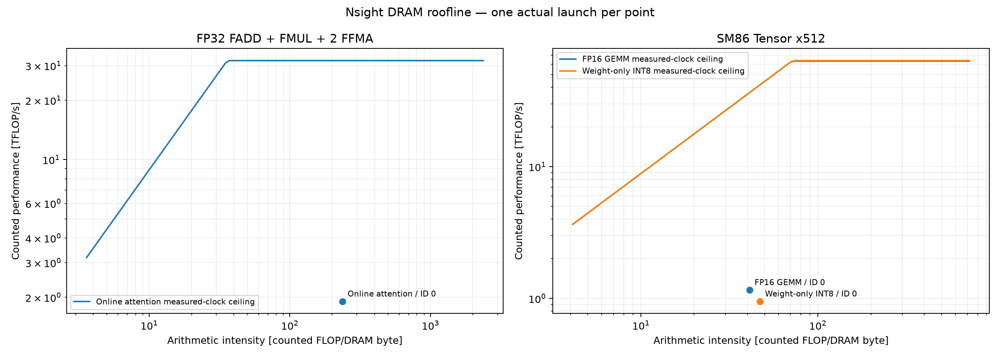
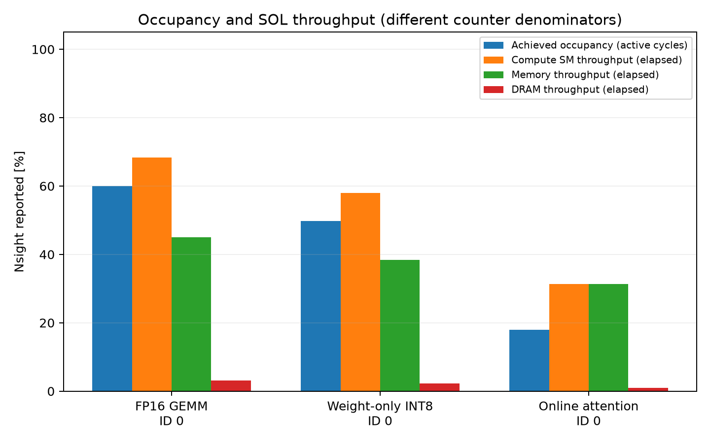

# Nsight capture postprocessing

`python -B -m bench.v2.profiling.postprocess --manifest <actual-captures.json> --output <new-result-directory>` processes retained standalone CUDA Nsight Compute reports after real build and correctness acceptance. It does not launch a profiler or access CUDA.

The manifest identifies a clean checkpoint, actual build/command receipts, profile executable/source hashes, the installed reviewed Nsight section files and exact launch IDs/kernel names. Each capture must retain its `.ncu-rep` and successful raw CSV export command. Use `--page raw --csv --print-units base`. The supported raw wide table has exact metric-name columns and a dedicated unit row; ambiguous, missing, N/A or differently scaled data fails explicitly. Check a real export before relying on the adapter.

The result package contains raw CSV copies, `summary.csv`, `roofline.png`, `occupancy.png` and `results.json` with commands, formulas, counter values/units and source/input/output hashes. Only `status=completed` accepts all outputs; preserve failed attempts separately. The plotting dependency is imported only after input validation.

Profiling command receipts must bind the actual ncu executable before/after version, capture and export, identify CLI version2024.1 from real version stdout, and share the approved recorder-source hash. The version receipt is an immutable input to capture/export. Each capture report must be absent before capture and its recorded output hash must equal both the export's input hash and current report bytes. A same path or a report hash computed only during postprocessing does not establish that chain.

WMMA and weight-only INT8 use the reviewed SM86 Tensor instruction x512 convention. The INT8 path dequantizes into FP16 WMMA, so it does not measure INT8 tensor-core arithmetic. SIMT attention uses predicated-on FADD + FMUL + 2 FFMA accounting, excluding its special-function and other instruction costs. Both rooflines use measured DRAM traffic and measured-clock ceilings. Tensor and FP32 count models are plotted separately. Occupancy uses active-cycle percentages; SM and memory throughput use elapsed-cycle percentages. A profiler-replayed single launch is not an end-to-end latency or an averaged timing result.

Retain the private full reports, completed build evidence and profiler companion-library inventory alongside the public CSV/PNG package. Source/fixture checks are preparation evidence; actual runtime captures and independent calculation/plot review are required for measured claims.

## Measured profiles

Three standalone Nsight Compute 2024.1 captures completed on the RTX 3080 in WSL2. The native build is pinned to `3edcfebd24d5efbf5da81cda13f2bf684031b35e`; capture commands were recorded at `0faa5148d1694a00c201846ac96fd2b98309f0da`, and the readable-label renderer at `b7fbeb201ab66a36d46dcbd5bdd1b68977b64229`. The [completed result JSON](../../../results/v2/20261102T221317Z-m2-profile-enabled-profile-labels/results.json) preserves the three identities, exact commands, section formulas and output hashes. The earlier long-label rendering is retained separately; these tables and figures use the readable-label output.

GEMM is 1024³, config0; the weight-only INT8 point uses the same dimensions/configuration and dequantizes to FP16 WMMA. Attention uses B=H=1, Q=K=1024, head dimension 64, causal mask and config0. The standalone launcher receives CLI config `1` for internal config0, prepares synthetic device inputs before launches, and invokes the same native backend.

Each point selects one kernel launch with `--launch-skip 5 --launch-count 1 --cache-control all --clock-control none`. Nsight may replay that launch to collect metrics. The ceilings use measured clocks, with no fixed-clock control, and measured DRAM traffic. These are single profiled launch points, not an average across independent trials, CUDA-event wrapper timings or end-to-end inference latency. Displayed decimals are rounded; linked JSON retains full precision.

| Profile point | Count model | Occupancy (%) | SM throughput (%) | Memory throughput (%) | Counted roofline (%) |
| --- | --- | --- | --- | --- | --- |
| FP16 GEMM | SM86 Tensor x512 | 59.95 | 68.40 | 45.09 | 3.171549 |
| Weight-only INT8 | SM86 Tensor x512 | 49.73 | 58.04 | 38.42 | 2.268871 |
| Online attention | FP32 FADD+FMUL+2×FFMA | 17.95 | 31.31 | 31.31 | 5.986942 |

[Summary CSV](../../../results/v2/20261102T221317Z-m2-profile-enabled-profile-labels/summary.csv) · [FP16 raw CSV](../../../results/v2/20261102T221317Z-m2-profile-enabled-profile-labels/raw/capture-000.csv) · [INT8-weight raw CSV](../../../results/v2/20261102T221317Z-m2-profile-enabled-profile-labels/raw/capture-001.csv) · [attention raw CSV](../../../results/v2/20261102T221317Z-m2-profile-enabled-profile-labels/raw/capture-002.csv).





The two GEMM points use the installed SM86 Tensor section's x512 instruction convention; this is instruction-derived work, distinct from the algorithmic `2*M*N*K` numerator in the [GEMM benchmark](../../../kernels/src/cuda/tc/README.md#gemm). The weight-only path counts FP16 WMMA, not INT8 Tensor Core arithmetic. Attention counts predicated-on FP32 FADD + FMUL + 2×FFMA and excludes special functions, conversion, integer and control work. The chart plots Tensor and FP32 models separately. Its percentage divides counted throughput by `min(measured-clock compute ceiling, arithmetic intensity × measured-clock DRAM ceiling)`, not by peak compute alone.

Occupancy is an active-cycle percentage; SM and memory throughput use elapsed-cycle denominators. Only a DRAM roofline is claimed. Full binary `.ncu-rep` files and exact capture/export receipts stay in the private run directory; public CSV copies remain byte-identical to their successful exports. Export with the actual supported command shape:

```bash
ncu --import "$REPORT" --page raw --csv --print-units base
```
